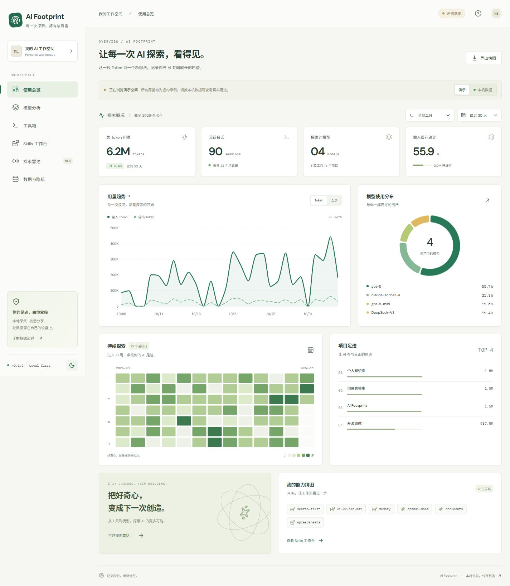

<div align="center">

# AI Footprint

**让每一次 AI 探索，看得见。**

一个本地优先的个人 AI 使用分析工作台。记录 Token、模型与项目足迹，整理 Skills，按需导出公开快照。

Vue 3 · TypeScript · ECharts · Java 21 · Spring Boot · SQLite

</div>



## 可以做什么

- **使用总览**：输入 / 输出趋势、缓存占比、活跃会话、13 周热力图、项目排行。
- **模型分析**：按工具和 7 / 30 / 90 天筛选，查看模型用量、会话及缓存占比。
- **工具箱**：真实连接状态与适配边界；当前本地采集支持 Codex。
- **Skills 工作台**：扫描用户与系统 Skills 安装清单，支持搜索和能力分类。
- **探索雷达**：OpenAI、Anthropic、DeepMind、DeepSeek、Qwen、Hugging Face 官方来源导航。
- **数据与隐私**：本机同步、采集覆盖提示、脱敏快照导出、浏览器内快照导入。
- **公开演示**：不需要后端即可部署到 GitHub Pages；示例数据始终标记为虚构。

这里的 Token 是日志统计，不是账单，也不是生产力分数。Skills 安装数不代表调用次数。探索雷达目前是来源导航，不是实时新闻流。

## 快速体验

环境：Node.js 22.12+、JDK 21、Maven 3.9+。仅看演示只需要 Node.js。

```sh
npm --prefix frontend ci
npm run dev
```

访问 `http://127.0.0.1:5173`，默认显示虚构示例，不自动读取本机数据。

### 连接本机数据

另开终端：

```sh
cd backend
mvn verify
java -Xmx256m -jar target/ai-footprint-0.1.0.jar
```

回到页面点击「本机数据」。后端启动时采集一次；后续在「数据与隐私」点击同步。服务只监听 `127.0.0.1:17890`，SQLite 位于项目 `.local/`，被 Git 忽略。

Windows 也可分别运行：

```powershell
.\scripts\start-backend.ps1
.\scripts\start-web.ps1
```

可选环境变量（启动后端前配置）：

| 变量 | 默认值 | 用途 |
|---|---|---|
| `AIF_CODEX_HOME` | 用户目录下 `.codex` | 仅读取 `sessions`、`archived_sessions` 与 `skills` |
| `AIF_DATABASE` | `../.local/footprint.db` | SQLite 路径，相对 backend 工作目录 |
| `AIF_TIMEZONE` | `Asia/Shanghai` | 日期聚合时区 |
| `AIF_PORT` | `17890` | 本地接口端口；调整后同步修改 Vite 代理 |

如果采集目录不存在或文件不可读，会保留此前快照；部分无效 JSONL 行会跳过并显示数量。

## 部署到 GitHub Pages

1. 将项目上传到自己的 GitHub 仓库，默认分支使用 `main`。
2. 仓库 **Settings → Pages → Source** 选择 **GitHub Actions**。
3. 执行 **Deploy demo to GitHub Pages** 工作流，或向 `main` 推送前端变更。

构建使用相对资源路径，兼容仓库子路径；页面导航采用 hash。Actions 只上传 `frontend/dist`，不会运行采集器或携带本机数据库。

公开站点默认展示虚构示例。你可以在本地导出公开快照，在公开站点用「数据与隐私 → 导入快照」浏览；导入仅发生在访问者浏览器内，不会把文件上传或自动保存为全站默认数据。

GitHub Pages 上的「本机数据」不会跨站连接你的本地服务。真实采集需要运行本机前后端。

## 数据怎么计算

```text
Codex JSONL / Skills frontmatter
             │  只保留计数与必要标签
             ▼
Java 采集适配器 → SQLite（本机）→ /api/snapshot → Vue 分析工作台
                                      │
                                 /api/export
                                      ▼
                         脱敏 JSON → 浏览器内导入
```

- 总 Token = 输入 + 输出。缓存 Token 已包含在输入中，推理 Token 已包含在输出中。
- 优先读取 `token_usage_record.usage`，按 `response_id` 跨文件去重。
- 对历史 `event_msg.token_count` 使用累计差值、处理计数重置；通过对应累计快照排除与新格式的重复计数。
- 模型来自请求记录或当时的 `turn_context`；缺失时标记 `unknown`，不按日期猜模型。
- 项目仅保留 `cwd` 最后一段名称；不同完整路径的同名目录会合并。
- 日志重新扫描后在事务内替换统计，重复同步不会叠加。第一版未做文件增量索引，日志很多时扫描耗时会增加。
- 旧格式分叉历史缺少全局响应身份，特殊压缩/历史改写可能有偏差；详见页面统计说明。仅覆盖本机可读日志，不宣称覆盖全部账号。

公开导出匿名化项目与 Skills 名称，排除对话、完整路径、原始会话 ID 和密钥。日期、模型与用量仍是活动信息，由使用者决定是否分享。

## 开发与验证

```sh
npm run test
npm run build
cd backend
mvn verify
```

GitHub CI 同时验证前端和后端。数据协议、技术决策和当前进度分别见 [架构说明](docs/ARCHITECTURE.md)、[项目进度](docs/STATUS.md) 与 [依赖及参考来源](docs/THIRD_PARTY.md)。

```text
frontend/         Vue 界面、ECharts 图表、Zod 快照校验与示例数据
backend/          Java 日志适配器、SQLite、只监听本机的 API
scripts/          Windows 启动入口、可复现虚构数据生成器
docs/             架构、统计边界、交付状态与演示截图
.github/workflows/ CI 和 GitHub Pages 部署
.local/           运行数据库与本机验证资料（不入 Git）
```

## 接下来

- Trae / Claude Code 等更多可验证的采集适配器。
- 带来源时间与抓取时间的官方动态聚合。
- 模型实验记录、AI 周报和个人学习时间线。
- 增量采集、多设备合并、用户选择的公开字段。
- MCP 清单与有调用证据的 Skill 使用分析。

## License

MIT。依赖保留各自许可证；见 [第三方说明](docs/THIRD_PARTY.md)。
