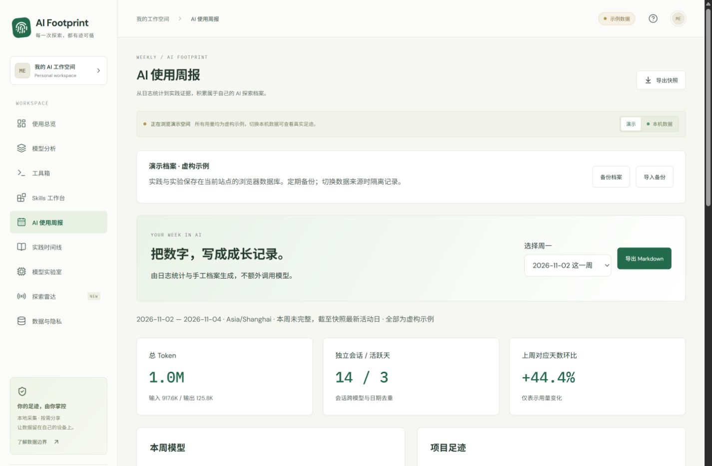
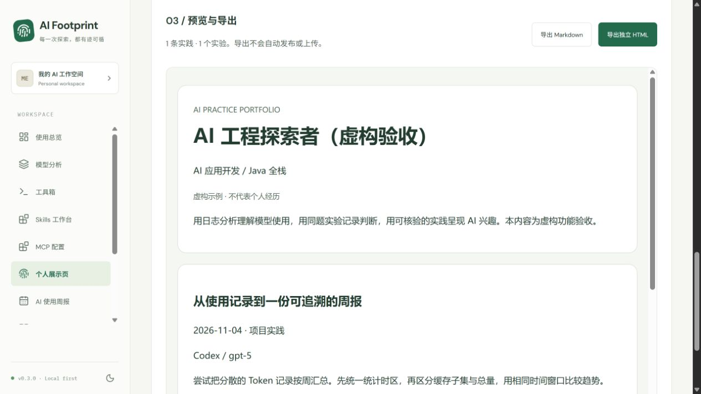

<div align="center">

# AI Footprint

**让每一次 AI 探索，看得见。**

一个本地优先的个人 AI 使用分析工作台。记录 Token、模型与项目足迹，整理 Skills、MCP 配置、实践与实验，生成使用周报和个人实践展示页。

Vue 3 · TypeScript · ECharts · Java 21 · Spring Boot · SQLite

[在线演示](https://danjiahao88-sys.github.io/TokenAnalysis/) · [源码](https://github.com/danjiahao88-sys/TokenAnalysis) · [构建状态](https://github.com/danjiahao88-sys/TokenAnalysis/actions)

</div>


## 可以做什么

- **使用总览**：输入 / 输出趋势、缓存占比、活跃会话、13 周热力图、项目排行。
- **模型分析**：按工具和 7 / 30 / 90 天筛选，查看模型用量、会话及缓存占比。
- **工具箱**：真实连接状态与适配边界；本地采集支持 Codex、Claude Code，没有有效日志时显示等待数据。
- **Skills 工作台**：扫描用户与系统 Skills 安装清单，支持搜索和能力分类。
- **探索雷达**：聚合 OpenAI 官方新闻、Codex 与 Claude Code 官方版本；保留原始标题、来源日期、抓取时间与失败状态，同时提供更多官方导航。
- **数据与隐私**：本机同步、采集覆盖提示、脱敏快照导出、浏览器内快照导入。
- **公开演示**：不需要后端即可部署到 GitHub Pages；示例数据始终标记为虚构。
- **AI 使用周报**：周一自然周、未完整周的等长环比，汇总用量与实践，导出 Markdown；不额外调用模型。
- **实践时间线**：记录任务、过程、成果、证据链接与下一步；支持搜索、分类、收藏、编辑、归档及恢复。
- **模型实验室**：同题、同验收标准记录 2–6 组模型的用量、耗时与人工评价；未知值留空，未验证组不计入通过率。

- **MCP 配置**：只读 Codex / Claude Code 用户级配置声明，展示传输类型与配置启用状态，不执行命令或测试连接。
- **个人展示页**：手动挑选实践与实验，预览后导出 Markdown / 无外部资源的独立 HTML，可用于 GitHub 作品与简历附件。

当前版本 **v0.4.0 已发布**，支持网站配对本机采集助手与自动更新。Windows 助手可从 [Releases](https://github.com/danjiahao88-sys/TokenAnalysis/releases/tag/v0.4.0) 下载；已在 Edge 验证实际 HTTPS 网站的配对、自动更新和刷新重连。发布与验收边界见 [项目进度](docs/STATUS.md)。

这里的 Token 是日志统计，不是账单，也不是生产力分数。Skills 安装数不代表调用次数。官方动态来自公开信息，与用量来源独立；是定时快照，不承诺实时或全模型覆盖。

## 快速体验

### 不使用命令查看自己的数据（Windows x64）

v0.4.0 提供自带 Temurin Java 运行环境的采集助手安装程序与便携包。首次从 [Releases](https://github.com/danjiahao88-sys/TokenAnalysis/releases) 下载并打开助手，在本机管理页生成配对码，再到网站输入一次。以后访问同一网站会自动重连，助手每 5 秒检查日志变化，网页自动更新，不需要运行终端或安装开发环境。

下载 [v0.4.0 Windows 安装程序](https://github.com/danjiahao88-sys/TokenAnalysis/releases/download/v0.4.0/AI-Footprint-Assistant-0.4.0-windows-x64-setup.exe)，或在同一版本下载页选择便携 ZIP 与 SHA256SUMS。详情、权限、自动启动、撤销授权、浏览器限制与打包方式见 [采集助手使用说明](docs/ASSISTANT.md)。首次仍需安装和配对；未安装的网页不能直接扫描电脑。支持浏览器可能要求允许本站访问本地网络，不能绕过浏览器或企业限制。

下面的命令方式适用于开发者与源码体验。

环境：Node.js 22.12+、JDK 21、Maven 3.9+。仅看演示只需要 Node.js。

```sh
npm --prefix frontend ci
npm run dev
```

访问 `http://127.0.0.1:5173`，默认显示虚构示例，不自动读取本机数据。

### 连接本机数据

另开终端：

```sh
cd backend
mvn verify
java -Xmx256m -jar target/ai-footprint-0.4.0.jar
```

回到页面点击「本机数据」。后端启动时采集，之后每 5 秒检查日志元数据，变化后重扫；每 60 秒至少重扫一次，网页自动读取新快照。也可在「数据与隐私」手动同步。服务只监听 `127.0.0.1:17890`，开发 SQLite 位于项目 `.local/`，被 Git 忽略；桌面安装版使用当前用户的独立数据目录。

Windows 也可分别运行：

```powershell
.\scripts\start-backend.ps1
.\scripts\start-web.ps1
```

可选环境变量（启动后端前配置）：

| 变量 | 默认值 | 用途 |
|---|---|---|
| `AIF_CODEX_HOME` | 用户目录下 `.codex` | 读取会话日志、Skills、MCP 声明与独立历史索引 |
| `AIF_CLAUDE_HOME` | 用户目录下 `.claude` | 仅读取 `projects` 内的会话及子代理 JSONL 计数元数据 |
| `AIF_CLAUDE_CONFIG` | 用户目录下 `.claude.json` | 只提取顶层 `mcpServers` 的声明元数据，不读取项目级 MCP |
| `AIF_DATABASE` | `../.local/footprint.db` | SQLite 路径，相对 backend 工作目录 |
| `AIF_TIMEZONE` | `Asia/Shanghai` | 日期聚合时区 |
| `AIF_PORT` | `17890` | 本地接口端口；调整后同步修改 Vite 代理 |

首次连接时缺失的工具目录视为无数据；已有用量的目录消失或任一文件不可读时保留此前快照。部分无效 JSONL 行会跳过并显示数量。本机尚无 Claude Code 日志，适配器以合成夹具验证，未声称已完成真实 Claude 会话联调。

### Codex 接入的模型没有出现在统计中

采集器接受日志中的任意模型名称，没有 DeepSeek 名称白名单。原始 JSONL 缺失时，请打开「本机数据 → 模型分析」下方的「Codex 历史索引 · 明细缺失」。v0.3.1 会只读最新版本的 `state_*.sqlite`，对仍有原日志的会话不再列入历史区，最多检查最近更新的 1,000 个索引会话，超限明确提示。

这里的 Token 是会话最后观察到的累计值，只能按索引最后记录的模型归组，可能包含模型切换或分叉历史。它不能还原输入 / 输出 / 缓存或每日明细，不代表该模型的精确账单；不应用日期筛选，不进入上方用量、趋势、占比、周报、公开快照或个人展示导出。索引原始模型标识按原样显示，不据用户口述改成其他版本。此区域仅本机来源可用，线上演示与导入的公开快照不读取它。

### 保存实践与实验

周报、实践、实验与展示配置共用当前站点的浏览器 IndexedDB。刷新或关闭标签后仍保留；清除站点数据、换浏览器、换域名或端口不会自动迁移。演示、本机、每份公开快照分别保存；演示档案与个人档案不能相互导入。公开快照的档案以其 `generatedAt` 区分，新导入不同时间的快照会进入独立空间。

点击「备份档案」下载 JSON，再用「导入备份」恢复；同 ID 保留 `updatedAt` 较新的版本。每个空间最多 500 条实践、300 个实验，归档仍占容量；备份导入上限 32 MB。档案备份和周报可能含你手工填写的私人笔记，不包含在用量公开快照中，也不会自动上传到 GitHub。模型实验为手工记录，不自动运行模型。v0.3 将数据库从版本 1 增至 2，保留既有记录；旧版备份可继续导入，展示配置随新版备份保存。





## 整理个人 AI 实践展示

1. 切换到本机数据，先在实践时间线与模型实验室记录自己的真实过程。
2. 打开「个人展示页」，填写名称、方向、简介与项目链接，勾选可分享的记录。
3. 检查预览；用量汇总和 Skills 名称默认关闭，只有勾选才加入。
4. 保存展示配置并备份档案，下载 Markdown 或独立 HTML。HTML 无脚本、无外部字体或资源，可单独打开和打印；自行检查文字与链接后再放入 GitHub。

实践导出日期、类别、工具、模型、过程、成果和 HTTPS 证据链接；实验导出任务、标准、指标、人工结论与备注。项目名和下一步字段不输出，但手工文字不会自动脱敏。展示页不是自动生成的个人业绩证明，演示导出保留虚构标识。

## 官方动态与 MCP 的范围

在 `frontend` 中运行 `npm run news:refresh` 可更新 `public/news.json`。三个固定官方源每源最多 20 条；抓取限制 15 秒、4 MB，不跟随跳转，拒绝 DTD / 实体声明。Atom 更新时间不冒充发布日期，无日期明确标未知。失败保留可用历史，分别记录本次检查和上次成功；超过 48 小时提示过期。

Pages 工作流每 12 小时尝试刷新，已随 v0.4 发布。GitHub 调度可能延迟，长期不活跃仓库的调度可能被平台暂停；页面只读取已发布快照，按钮不会触发抓取。Actions 优先读取上次发布的新闻作为失败回退，不可用时用仓库内快照；不自动提交新闻文件。

MCP 仅覆盖 Codex 用户 `config.toml` 与 Claude 用户 `.claude.json` 顶层声明；不扫描项目配置、插件缓存或任意目录。不跟随配置文件本身的符号链接；单文件限 1 MB、每来源 200 项。返回短名称、工具、传输类型、启用声明与来源状态；不返回地址、命令、参数、环境变量、请求头、配置原文或路径。MCP 清单不进入 `/api/export`，也不进入个人展示导出。安装、配置启用、连接成功、实际调用是不同的证据。

## 部署到 GitHub Pages

当前仓库的在线演示已部署到 [GitHub Pages](https://danjiahao88-sys.github.io/TokenAnalysis/)。Fork 后可按以下步骤发布自己的版本：

1. 将项目上传到自己的 GitHub 仓库，默认分支使用 `main`。
2. 仓库 **Settings → Pages → Source** 选择 **GitHub Actions**。
3. 执行 **Deploy demo to GitHub Pages** 工作流，或向 `main` 推送前端变更。

构建使用相对资源路径，兼容仓库子路径；页面导航采用 hash。Actions 只上传 `frontend/dist`，会读取公开官方动态，不会运行本机使用量采集器或携带本机数据库。

公开站点默认展示虚构示例。你可以在本地导出公开快照，在公开站点用「数据与隐私 → 导入快照」浏览；导入仅发生在访问者浏览器内，不会把文件上传或自动保存为全站默认数据。

已配对的 v0.4 网站可通过独立的 `/bridge/` 接口连接当前电脑的助手，不需要本机前端。原 `/api/` 不开放跨站读取。网站令牌按精确来源绑定、可撤销，助手只保存令牌哈希；配对码 5 分钟有效、一次使用、限制尝试次数。未配对不读取私有数据，切演示 / 公开快照暂停自动读取，断线保留旧数据并明确提示。真实用量不会作为网站默认数据或自动上传 GitHub。

## 数据怎么计算

```text
Codex / Claude Code JSONL / Skills frontmatter
             │  只保留计数与必要标签
             ▼
Java 采集适配器 → SQLite（本机）→ /api/snapshot → Vue 分析工作台
                                      │
                                 /api/export
                                      ▼
                         脱敏 JSON → 浏览器内导入
```

- 总 Token = 输入 + 输出。缓存 Token 已包含在输入中，推理 Token 已包含在输出中。
- 优先读取 `token_usage_record.usage`，按 `response_id` 跨文件去重。
- 对历史 `event_msg.token_count` 使用累计差值、处理计数重置；通过对应累计快照排除与新格式的重复计数。
- Claude Code 的输入归一化为非缓存输入 + 缓存读 + 缓存写；缓存命中只计缓存读。相同 message / request 的流式片段与复制日志按计数最大值合并，不逐片叠加。
- 模型来自请求记录或当时的 `turn_context`；缺失时标记 `unknown`，不按日期猜模型。
- 项目仅保留 `cwd` 最后一段名称；不同完整路径的同名目录会合并。
- 日志重新扫描后在事务内替换统计，重复同步不会叠加。第一版未做文件增量索引，日志很多时扫描耗时会增加。
- 旧格式分叉历史缺少全局响应身份，特殊压缩/历史改写可能有偏差；详见页面统计说明。仅覆盖本机可读日志，不宣称覆盖全部账号。

公开导出匿名化项目与 Skills 名称，排除对话、完整路径、原始会话 ID 和密钥。日期、模型与用量仍是活动信息，由使用者决定是否分享。

## 开发与验证

```sh
npm run test
npm run build
cd backend
mvn verify
```

GitHub CI 同时验证前端和后端。数据协议、技术决策和当前进度分别见 [架构说明](docs/ARCHITECTURE.md)、[项目进度](docs/STATUS.md) 与 [依赖及参考来源](docs/THIRD_PARTY.md)。

```text
frontend/         Vue 界面、ECharts 图表、Zod 快照校验与示例数据
backend/          Java 日志适配器、SQLite、只监听本机的 API
scripts/          Windows 启动入口、可复现虚构数据生成器
docs/             架构、统计边界、交付状态与演示截图
.github/workflows/ CI 和 GitHub Pages 部署
.local/           运行数据库与本机验证资料（不入 Git）
```

## 接下来

- Trae 等更多可验证的采集适配器；目前调研到的自动方案依赖解密密钥提取，暂不采用。
- Claude Code 真实会话联调、更多版本与分叉格式覆盖。
- 增量采集、多设备合并、用户选择的公开字段。
- 项目级 MCP 配置覆盖与有调用证据的 Skill 使用分析。

## License

MIT。依赖保留各自许可证；见 [第三方说明](docs/THIRD_PARTY.md)。
